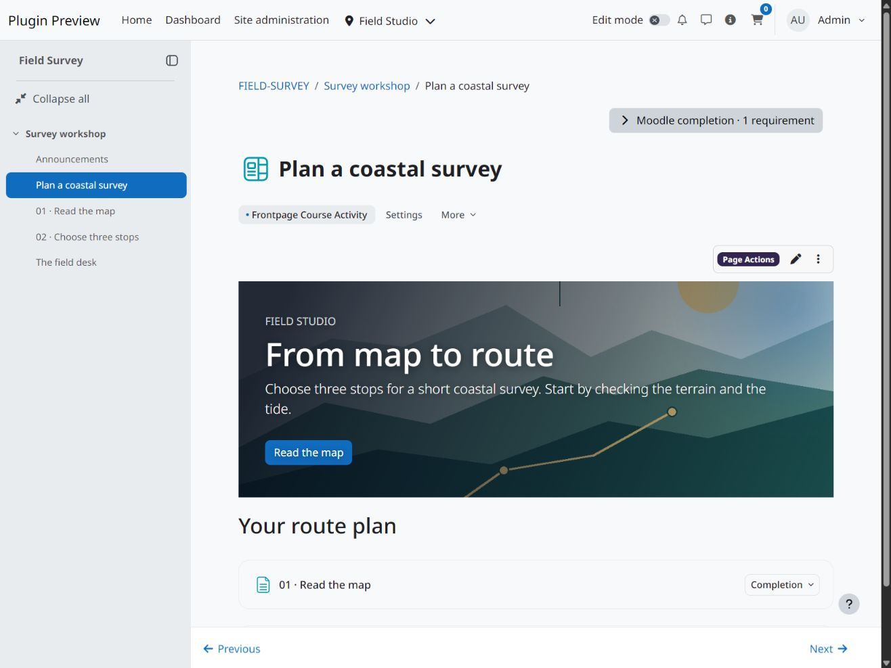
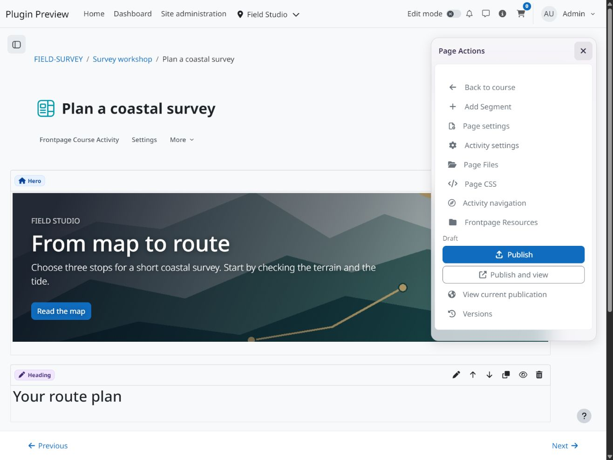
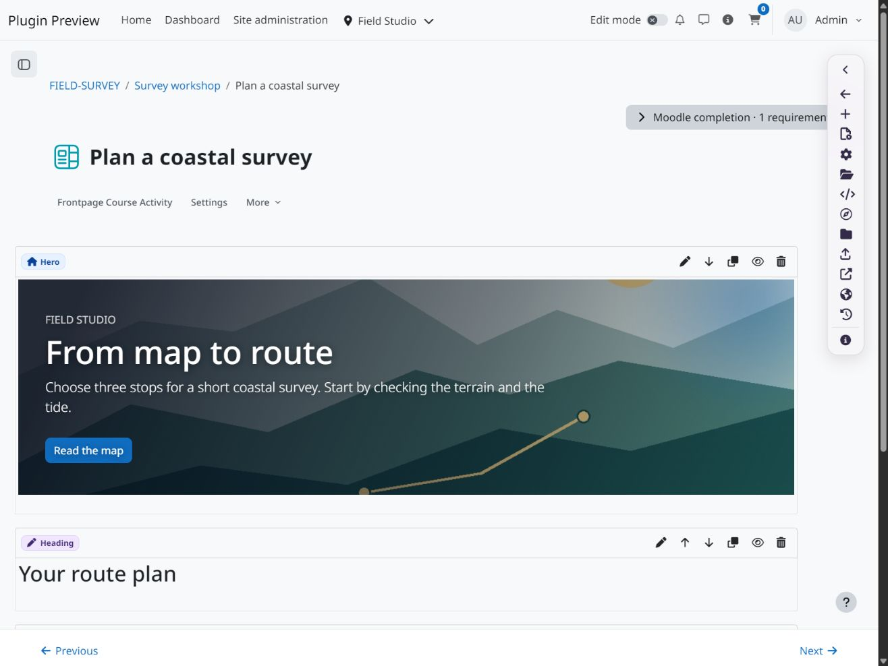

  

# Frontpage Course Activity LE

Build a course activity page with headings, Moodle rich text, static images and Hero content, spacers and responsive grids. Course lists and references to activities in the same course use Moodle’s native access rules.

## Screenshots

View screenshots

## Installation and editing

Supports Moodle 4.5 through 5.3. Install [Frontpage](https://github.com/108design/moodle-local_frontpage-le) build `2026010108` or later first. Then download the [signed beta ZIP](https://github.com/108design/moodle-mod_frontpage-le/releases) and install it as `mod/frontpage`.

Add **Frontpage** through Moodle’s activity chooser. Use **Edit Content** to build the page, save a draft and preview it. Choose **Publish** to make the draft available to learners. Later edits leave that publication visible until you publish again.

Teachers with **Manage activity content** can edit the page. **Publish activity content** controls publication. Moodle manages the activity name, description, visibility, availability and completion.

## Completion and reuse

Native manual and view completion are available. The optional **All Referenced Activities** rule uses enabled activity references from the current publication and requires at least one activity with completion tracking. Untracked activities are skipped. Missing or deleted references keep the rule incomplete. Hidden or temporarily unavailable tracked activities use their native completion state. Historical previews do not award completion.

Moodle activity and course backups, course copy and duplication retain the page’s drafts, publications and files. References included in the same restore receive their target IDs. Missing target activities become placeholders for an editor to resolve. References retained within the same course continue to point to that course’s activities.

Open **Frontpage Resources** in the course navigation to review resources created through Frontpage. Removing a page or segment preserves those activities and their user data.

## License

This release is available free of charge under the 108design Software License.

See [LICENSE.md](LICENSE.md) for the terms and Moodle Marketplace permission.
